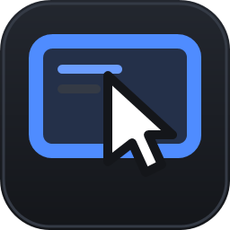
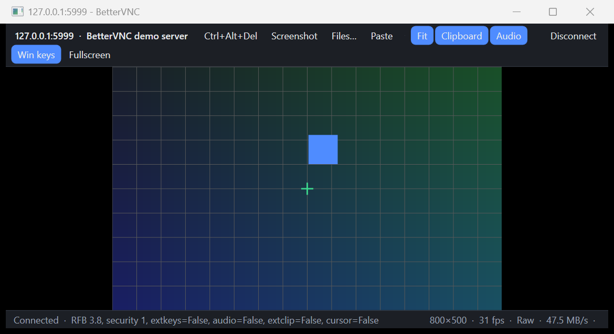

#  BetterVNC

A modern VNC viewer for Windows that makes Unraid VM consoles and macOS Screen Sharing feel
like an RDP session: local cursor, raw keyboard, two-way clipboard, file drop, audio, fullscreen
with Windows-key capture, and one-click VM discovery on Unraid.



## Why

Unraid's built-in noVNC console runs in a browser tab: no clipboard without extra setup, lossy
keyboard mapping, no audio, no file transfer, no fullscreen capture of Win/Alt+Tab, and a
pointer that lags behind. macOS Screen Sharing is only pleasant from another Mac. BetterVNC
talks RFB directly to both servers and uses every extension they offer, then fills the gaps
RFB cannot cover (files, images) with an SFTP/SMB side channel.

See [docs/ANALYSIS.md](docs/ANALYSIS.md) for the full analysis of what QEMU's and Apple's
servers support and how each feature is implemented.

## Features

| Area | What you get |
|---|---|
| Unraid | Add an Unraid server once (SSH). Browse VMs, see their state, start them, and connect; the current VNC port and password are read from the VM definition every time, so autoport changes never break a saved connection. Warns when a VM lacks the clipboard agent channel or still has a keymap set. |
| macOS | Native Apple Remote Desktop authentication (security type 30) with your macOS user name and password, plus classic VNC-password mode. Mac keyboard modes: Win = Cmd, Ctrl = Cmd, or swapped Alt/Win. |
| Picture | Tight (lossless on LAN), ZRLE, Hextile, Zlib, RRE, CopyRect, Raw. Fit-to-window or 1:1 with DPI-correct scaling. Remote resolution changes follow automatically. A **Picture** box in the toolbar switches between lossless VNC, compressed VNC (Tight JPEG) and, with the guest agent, a [video stream of the screen](#picture-modes-and-screen-streaming) that costs a fraction of the bandwidth when things move. |
| Pointer | Remote cursor shapes become real Windows cursors, so the pointer never lags. Horizontal and vertical scroll. |
| Keyboard | Raw XT scancodes via the QEMU extended key event (every key works exactly like a plugged-in keyboard, any layout). Windows key, Alt+Tab, Alt+F4, Ctrl+Esc captured in fullscreen or on demand. Ctrl+Alt+Del button. Keys are released on focus loss. |
| Clipboard | Text both ways: TigerVNC/QEMU extended clipboard (UTF-8) or legacy cut text. Screenshot button copies the remote screen as an image (Shift+click saves PNG). |
| Files and images | With the [guest agent](#guest-agent) running in the remote machine the clipboard works like RDP: copy an image or files on either side and paste on the other. Without it, dragged or pasted files and images are uploaded to a drop folder over SFTP or SMB and the remote path lands on the remote clipboard. |
| Scrolling | With the guest agent the wheel and touchpad scroll by pixels, as a trackpad would ([smooth scrolling](#smooth-scrolling)). Without it, RFB wheel clicks with a per-connection "wheel clicks per notch" multiplier and a velocity boost, because macOS moves only about a line per click. |
| Audio | QEMU VNC audio extension: hear your Unraid VM (needs a sound device in the VM). |
| Secrets | Passwords stored with Windows DPAPI in `%AppData%\BetterVNC\profiles.json`. |
| Shortcuts | `BetterVNC.exe host:port [--fullscreen]` or `vnc://host:port` opens a session directly. |

## Building

Requires the .NET 10 SDK on Windows.

```bash
dotnet build BetterVNC.slnx -c Release
```

Run the app from `src/BetterVnc.App/bin/Release/net10.0-windows/BetterVNC.exe`, or publish a
single folder:

```bash
dotnet publish src/BetterVnc.App -c Release -r win-x64 --self-contained false -o publish
```

### Tests

The protocol library is covered by tests that run the client against an in-process fake RFB
server over real sockets (handshake, VNC and Apple authentication, every decoder, cursor,
resize, clipboard, QEMU key/audio messages). They are built as a standalone executable:

```bash
dotnet build tests/BetterVnc.Protocol.Tests && tests/BetterVnc.Protocol.Tests/bin/Debug/net10.0/BetterVnc.Protocol.Tests.exe
```

`dotnet test` also works on machines without Smart App Control. With Smart App Control on,
Windows refuses to load the unsigned test DLL into Microsoft's signed `testhost.exe`, which is
why the tests are an exe.

### Demo server

`tools/BetterVnc.DemoServer` is a tiny RFB server (animated pattern, echoes keys, pointer and
clipboard) for developing without a real VM:

```bash
dotnet run --project tools/BetterVnc.DemoServer -- 5999
```

Then `BetterVNC.exe 127.0.0.1:5999`.

## Setting up the servers

### Unraid VM: clipboard

QEMU only syncs the clipboard when the guest runs a SPICE vdagent and the VM has a
`qemu-vdagent` channel. Edit the VM XML (VM, Edit, toggle XML view) and add inside `<devices>`:

```xml
<channel type='qemu-vdagent'>
  <source>
    <clipboard copypaste='yes'/>
    <mouse mode='client'/>
  </source>
  <target type='virtio' name='com.redhat.spice.0'/>
</channel>
```

Inside the guest install `spice-vdagent` (Linux) or the SPICE guest tools / `vdagent` from the
virtio-win ISO (Windows). The VM browser in BetterVNC shows which VMs are missing this.

### Unraid VM: exact keyboard

Remove `keymap='en-us'` from the `<graphics type='vnc' ...>` element. QEMU then uses the raw
scancodes BetterVNC sends and the guest's own layout applies to every key.

### Unraid VM: audio

Give the VM a sound device (`<sound model='ich9'/>` in the XML; Unraid 6.12+ exposes this in
the VM form). libvirt's default `<audio type='none'/>` backend already lets the VNC server
stream it.

### macOS

System Settings, General, Sharing: enable Screen Sharing (or Remote Management). Connect with
your macOS user name and password. For images and files install the [guest agent](#guest-agent);
as a fallback enable Remote Login and configure SFTP in the connection with the same account and
a drop folder such as `~/Desktop/Drop`.

## Guest agent

RFB carries text only. The **BetterVNC guest agent** (`bettervnc-agent`, in `tools/BetterVnc.Agent`)
is a small program that runs inside the VM or on the Mac and gives the viewer a second channel next
to VNC. With it connected the clipboard behaves like an RDP session:

| Direction | What happens |
|---|---|
| Copy an image on Windows (screenshot, browser, Paint) | It is on the remote clipboard a moment later, as PNG plus a bitmap for apps that only read DIBs. |
| Copy an image in the remote | It is on the Windows clipboard (PNG with alpha, plus a bitmap). |
| Drop files on the session, click Files…, or Paste with files on the clipboard | The files are copied to the remote and placed on its clipboard, ready to Ctrl+V in Explorer, Finder or a file manager. |
| Copy files in the remote | They are pulled to `%TEMP%\BetterVNC\<connection>\` and put on the Windows clipboard as a file list (up to 64 MB per copy; larger sets are only announced in the status bar). |
| Copy text | Still travels over VNC. When the agent is connected the viewer also receives it through the agent, which keeps full Unicode on Macs (Apple's VNC server is Latin-1 only). |
| Scroll | The wheel is sent as pixel deltas and injected natively (see [Smooth scrolling](#smooth-scrolling)). |
| Picture | The agent can stream its screen as video so a moving picture costs a few Mbit/s instead of tens (see [Picture modes and screen streaming](#picture-modes-and-screen-streaming)). |

The status bar shows `agent` among the session features once the connection is up, and the
`Files…`, `Paste` and drag-and-drop paths prefer the agent over the SFTP/SMB drop folder.

### Picture modes and screen streaming

VNC sends the pixels that changed, losslessly by default. That is nearly free while you type and
very expensive while a video plays or a page scrolls, because then every pixel changes and a
1080p screen becomes 100 Mbit/s or more. The **Picture** box in the session toolbar lets you pick
per session where the pixels come from; the connection settings hold the default, and a right-click
on the box makes the current choice the default.

| Picture mode | What it does | Available when |
|---|---|---|
| VNC lossless | Exact pixels over RFB (Tight on QEMU, ZRLE on macOS). | Always. |
| VNC compressed, high / medium / low | Tight JPEG quality 9 / 6 / 3 on the live connection. Switching re-sends the whole screen at the new quality. | The server honours lossy requests. QEMU does so only when the VM's VNC server is started with `lossy=on` (libvirt does not expose it; use a `<qemu:commandline>` override). The status bar says `JPEG n` once JPEG rectangles arrive and `requested (none received yet)` while the server ignores the request. macOS Screen Sharing has no lossy encoding, so these entries are greyed out there. |
| Stream, quality / balanced / low bandwidth | The guest agent captures the screen and sends it as H.264 video (motion JPEG with old agents) at about 20 / 8 / 2.5 Mbit/s. RFB stays connected underneath for input, cursor shapes and resizes, polled once a second. Whenever the screen is still for 0.7 s the viewer switches back to the lossless RFB picture and asks for a full update, so a quiet desktop is always pixel-exact; the next frame switches back to the stream. | The guest agent is connected, is a build that announces `video`, runs on Windows (macOS and Linux capture are not done yet) and has `enableVideo` on (default; also a checkbox in the tray settings). Greyed out otherwise, with the reason in the tooltip. A plain VNC connection without an agent shows only the VNC entries. |

Choosing a stream mode before the agent is up is fine: the session starts on lossless VNC and the
stream takes over the moment the agent connects, the same way the clipboard features light up. If
the agent goes away the picture falls back to VNC and the stream resumes when it is back.

The codec is negotiated per stream: the viewer lists what it decodes in `startVideo` (`h264`,
then `jpeg`) and the agent takes the first one it can encode, so an old viewer and a new agent, or
the other way round, still meet on motion JPEG.

**H.264** is what a Windows agent and the viewer normally agree on. The agent captures with DXGI
Desktop Duplication, which hands over a frame only when something was drawn, so an unchanged screen
costs nothing and the viewer's idle fallback keeps working; where duplication is unavailable (RDP
sessions, the secure desktop, basic display adapters) it falls back to GDI polling with a pixel
compare. Frames are converted to NV12 on the capture thread and encoded by the Media Foundation
H.264 encoder: the GPU vendor's hardware encoder when one is registered (AMD, Intel and NVIDIA all
ship one; `videoStarted` then reports `encoder: hardware`), otherwise Microsoft's software encoder.
The stream is CBR at the requested bitrate with no B-frames and low-latency mode; the bitrate is
re-tuned in place when the picture mode changes; key frames are sent only when needed (stream start,
a dropped frame, a resolution change, a viewer's request) and every key frame carries SPS and PPS;
the padding hardware encoders add to hold CBR is stripped before sending. The viewer decodes with
Microsoft's Media Foundation H.264 decoder in low-latency mode on a worker thread, converts NV12 to
BGRX and shows the newest picture when it falls behind (older ones are still decoded, they are the
references); a gap in the frame sequence, on either side, makes it ask for a key frame and wait for
it. A desktop wider or taller than H.264 allows (4096×2304, i.e. several monitors side by side) is
streamed as its primary display only. Measured with `bettervnc-agent probe … video` against a local
agent on a 2256×1504 display with an AMD Radeon 890M (hardware encoder), a 1200×800 window of
random colour blocks repainting at 60 Hz:

| Picture mode | Frames per second | Bitrate seen |
|---|---|---|
| Stream, quality (20 Mbit/s, 60 fps cap) | 56 to 60 | 8 to 9.5 Mbit/s (that is all this picture needs) |
| Stream, balanced (8 Mbit/s, 60 fps cap) | 56 to 61 | 6 to 6.8 Mbit/s |
| Stream, low bandwidth (2.5 Mbit/s, 30 fps cap) | 30 | 2.4 to 2.9 Mbit/s |

With every pixel of the display changing every frame the encoder still delivered 57 fps at the
60 fps presets; the capture thread spends about 9 ms per frame on the BGRA to NV12 conversion and
the upload, the encoding itself runs on the GPU in parallel. Motion JPEG on the same display managed
about 7 fps at 8 Mbit/s.

**Motion JPEG** is the fallback that needs no codec on either side: every changed frame is a complete
JPEG, captured with GDI. The bitrate is held by pacing (each frame earns a pause proportional to its
size) and the JPEG quality trades frame rate against sharpness. Because every frame is a whole
picture, the frame rate is what gives: expect single-digit frame rates at a few Mbit/s on a large
desktop. Linux and macOS agents do not stream yet.

The stream travels over the agent's TCP connection, which is authenticated but not encrypted: keep it
on the LAN or inside an SSH tunnel.

To check a stream from the command line:

```bash
bettervnc-agent probe <guest-ip> <token or pair> video 8000 60 5 first-frame.h264
bettervnc-agent probe <guest-ip> <token or pair> video 8000 30 5 first-frame.jpg jpeg
```

### How it works

The agent listens on TCP **5970** (configurable) inside the guest. Frames are a JSON header plus
a binary payload, each length-prefixed; messages are `hello`/`welcome` (handshake), `clipboardChanged`
(agent to viewer, lists the formats on the guest clipboard), `getClipboard`/`clipboardData` and
`setClipboard`/`ok` for the formats `text`, `html`, `png` and `files` (a file set is one payload with
the relative names and sizes in the header), and `scroll` (viewer to agent, no reply: `dx`/`dy` in pixels,
`phase` begin/continue/end, optional pointer position and the raw Windows wheel delta). The `welcome` lists
the agent's optional `features` (`scroll`, `video`), so an old agent is simply never sent scroll events or
asked for a stream. Streaming uses `startVideo` (viewer lists the `codecs` it decodes, wanted `bitrate` in kbit/s
and `maxFps`) answered by `videoStarted` (negotiated codec, bitrate, fps, size, `encoder` hardware/software),
`setVideo`/`ok` to re-tune or ask for a key frame, `stopVideo`/`ok`, `videoFrame` (agent to viewer, one encoded
frame per payload with `sequence`, `timestamp`, `keyframe`, `width`, `height`) and `videoStopped` (agent to
viewer when its capture ends).

**Who may connect.** Two ways, both usable at the same time:

* **Pairing (default).** The viewer has an identity (a random id plus the PC name, created once per
  Windows user in `%AppData%\BetterVNC\viewer.json`). On the first connection it sends `pair` with an
  ephemeral ECDH P-256 public key; the agent shows a dialog on the guest screen ("BetterVNC on TIM-PC
  asks to use this computer's clipboard… Allow / Deny", 90 s timeout). You see that dialog through the
  VNC session and click Allow. The agent answers `paired` with its own public key, both sides derive
  the same 32-byte key, the agent stores it under the viewer id in its config and the viewer stores it
  DPAPI-protected in the connection profile. Only someone who can already click on the guest screen can
  approve, and the key never crosses the wire.
* **Token or password.** A value set in the agent's settings; the viewer stores it DPAPI-protected in the
  profile (choose "Token or password" in the connection editor). Handy for scripts, for guests without a
  dialog tool, or when you turn pairing off.

Every later connection, in either mode, is a nonce/HMAC-SHA256 exchange in both directions: the viewer
proves it knows the key or token, the agent proves the same back. If the agent no longer knows the
viewer (removed in its settings, reinstalled) it answers `notPaired` and the viewer simply pairs again.
The connection itself is not encrypted: use it on the LAN or VPN, or bind the agent to `127.0.0.1` and
reach it through an SSH tunnel.

### Building the packages

```bash
powershell -ExecutionPolicy Bypass -File tools/BetterVnc.Agent/publish-agent.ps1
```

This publishes the agent as one self-contained executable per platform (no .NET needed in the
guest) and wraps each in an archive under `publish/`: `bettervnc-agent-<version>-win-x64.zip`,
`…-linux-x64.tar.gz`, `…-linux-arm64.tar.gz`, `…-osx-arm64.tar.gz` (Apple Silicon) and
`…-osx-x64.tar.gz` (Intel Mac). Each archive holds the binary, `INSTALL.txt` and, for Linux and
macOS, `install.sh`. `-Rids osx-arm64,win-x64` limits the set.

### Installing

Copy the archive to the remote machine, unpack it and run the installer once in a terminal there:

| Remote | Command |
|---|---|
| Windows guest | `bettervnc-agent.exe install` (in the unpacked folder) |
| Linux guest | `tar xzf bettervnc-agent-*-linux-x64.tar.gz && sh bettervnc-agent-*-linux-x64/install.sh` |
| macOS | `tar xzf bettervnc-agent-*-osx-arm64.tar.gz && sh bettervnc-agent-*-osx-arm64/install.sh` |

`install` needs no administrator rights. It copies the agent into a per-user location, writes the
config (an existing one with its pairings and token is kept, so reinstalling does not break saved
connections), registers it to start at login with the OS's own mechanism and starts it:

| Remote | Program and config | Autostart | Log |
|---|---|---|---|
| Windows | `%LOCALAPPDATA%\Programs\BetterVNC Agent\` | scheduled task "BetterVNC agent" at logon (hidden window); a firewall rule is added if the prompt is elevated, otherwise Windows asks once | next to the program |
| Linux | `~/.local/bin/bettervnc-agent`, `~/.config/bettervnc-agent.json` | systemd user service `bettervnc-agent` (or `~/.config/autostart` without systemd) | `~/.local/state/` |
| macOS | `~/Library/Application Support/BetterVNC/` | LaunchAgent `~/Library/LaunchAgents/com.bettervnc.agent.plist` | `~/Library/Logs/bettervnc-agent.log` |

Options: `install --port 5971` or `--listen 127.0.0.1` (then reach it through an SSH tunnel).
`install --dry-run` only shows what would be done. `uninstall` stops the agent and removes all of it.

In BetterVNC, edit the connection and tick **Use the guest agent**. Leave "Pair with a click in the
remote" selected, connect, and click **Allow** in the dialog that appears on the remote screen; from
then on the two are paired. The agent host defaults to the VNC host, which is right for a Mac. For an
**Unraid VM the VNC host is the Unraid server**, so enter the VM's own IP address or host name as the
agent host. The macOS firewall asks once whether to allow incoming connections; on a Linux guest with
an active firewall open TCP 5970 (`ufw allow 5970/tcp`).

### Settings: tray icon and menu bar item

On Windows the agent lives in the notification area (tray), on macOS in the menu bar; both show the
BetterVNC icon. The menu shows the listening address and the connected and paired viewers, and opens
the settings: port, listen on all networks or only this computer, allow new pairings, the token or
password (generate, show, clear), the list of paired viewers with a Remove button, start at login, and
the log. Changes apply immediately (the listener restarts; connected viewers reconnect by themselves).
On Windows the settings are one window; on macOS each menu entry opens a small dialog.

The same settings are available from the command line, which is what a Linux guest uses:

```
bettervnc-agent token show | set <value> | generate | clear
bettervnc-agent viewers [remove <name or id>]
bettervnc-agent pairing on | off
```

A running agent picks up command-line changes after a restart; the tray and menu bar apply them at once.

### Running it by hand

`bettervnc-agent` without a command just serves (in the tray or menu bar; `--console` keeps it in the
terminal instead). On first start it writes `bettervnc-agent.json` next to the executable (or where
`--config` points) with pairing on and no token. The file also holds `port`, `listen` (`0.0.0.0` or
`127.0.0.1`), `maxPayloadMb`, `allowPairing`, `token` and `viewers`. The agent must run in the
logged-in user's desktop session on every OS, because that is where the clipboard and the approval
dialog live: not as a Windows service, and on Linux with `DISPLAY` or `WAYLAND_DISPLAY` set.

### Per-OS notes

* **Windows**: the Windows Forms clipboard on a dedicated STA thread; images are offered as PNG and
  as a flattened bitmap, file lists carry a "copy" drop effect.
* **Linux**: `xclip` on X11 or `wl-paste`/`wl-copy` on Wayland (`apt install xclip wl-clipboard` or
  the distro equivalent). Both serve one target each, so a pasted file list is offered as
  `text/uri-list` (or GNOME's `x-special/gnome-copied-files` when `XDG_CURRENT_DESKTOP` says GNOME).
  The pairing dialog uses `zenity`, `kdialog` or `xmessage`; without one of them set a token. There is
  no tray icon on Linux; use the command line.
* **macOS**: text through `pbcopy`/`pbpaste`; images, files, HTML and change detection through
  `osascript` (JavaScript for Automation against `NSPasteboard`). Nothing needs to be installed. The
  binary is unsigned, so `install.sh` clears the download quarantine before running it.

### Smooth scrolling

VNC has no scroll wheel, only buttons 4 to 7, and macOS Screen Sharing turns each press into about one
line, so a wheel notch barely moves anything (the viewer's "wheel clicks per notch" slider and its
velocity boost are the stopgap for agent-less connections). With the agent connected the viewer stops
sending wheel buttons and instead sends each wheel or touchpad event as pixels: a notch is
`WHEEL_DELTA / 120 × Windows "lines per notch" × 16 px`, so one notch scrolls as far as it does in a
local window, and precision touchpads keep their fractional, continuous motion. The agent injects it
at the current pointer position:

| Guest | How | Notes |
|---|---|---|
| macOS | `CGEventCreateScrollWheelEvent2` with pixel units and trackpad phases, posted to the HID event tap | Needs the **Accessibility** permission (below). |
| Windows | `SendInput` with `MOUSEEVENTF_WHEEL` / `MOUSEEVENTF_HWHEEL`, replaying the original wheel delta | A notch is a notch; the guest's own "lines per notch" setting applies. |
| Linux | `xdotool click 4/5/6/7` (X11) or `ydotool mousemove --wheel` (Wayland, needs `ydotoold`) | Best effort: one click per 48 px. Without either tool the feature is not announced. |

If the agent is not connected, or is an older build, the viewer falls back to VNC wheel clicks and the
slider keeps working.

`bettervnc-agent.json` has `enableScroll` (default `true`), `scrollScale` (multiplier, e.g. `1.5` for a
faster Mac), and for macOS `scrollInvert` (if the direction comes out reversed on your Mac) and
`scrollPhases` (set to `false` if an app misbehaves with trackpad-style gestures). Restart the agent
after editing.

**macOS permission.** Posting input events requires Accessibility. On the first scroll the agent asks
macOS to show the permission prompt; if it does not appear (the agent runs from a LaunchAgent), open
System Settings, Privacy & Security, Accessibility, click **+**, press Cmd+Shift+G and enter the path
of `bettervnc-agent` (for example `/usr/local/bin/bettervnc-agent`), then enable it. When you start the
agent from Terminal for a test, Terminal itself must be allowed as well. The permission is tied to the
binary: after replacing it with a new build, remove and re-add the entry if scrolling stops. The agent
prints `Accessibility permission missing` at startup while it is not granted, and
`bettervnc-agent probe <host> <token> scroll 0 -240` scrolls the window under the Mac's pointer down by
240 px to test it. Since the viewer already keeps the Mac's pointer where yours is, scrolling lands in
the window under the mouse, as it does locally.

### Testing from the command line

`bettervnc-agent probe <host[:port]> <token> info` checks the handshake and shows the formats on
the remote clipboard (`pair` instead of the token pairs the probe the way the viewer does); `probe … watch` prints change notifications; `probe … get png out.png`,
`probe … set png in.png`, `probe … set files <paths>` and `probe … get files <dir>` move data by hand;
`probe … scroll <dx> <dy> [steps]` injects a scroll gesture (pixels, `dy > 0` is up);
`probe … video [kbit/s] [fps] [seconds] [first-frame.jpg]` starts a screen stream and prints frames and bandwidth per second.
The agent framing, authentication and request handling are covered by `tests/BetterVnc.Agent.Tests`
(an executable like the protocol tests; `dotnet tests/BetterVnc.Agent.Tests/bin/Debug/net10.0/BetterVnc.Agent.Tests.dll`
also runs it).

## Project layout

```
src/BetterVnc.Protocol        RFB client library (no UI): handshake, security, decoders, clipboard, QEMU extensions
src/BetterVnc.Agent.Protocol  Guest agent wire protocol, server core and viewer-side connection (no UI, no OS code)
src/BetterVnc.App             WPF viewer
tests/                        Protocol tests with a fake RFB server; agent tests with a fake clipboard
tools/BetterVnc.Agent         Guest agent executable (Windows, Linux, macOS clipboard back ends)
tools/BetterVnc.DemoServer    Development VNC server
tools/BetterVnc.IconGen       Renders the app icon (src/BetterVnc.App/Assets/BetterVNC.ico and icon.svg) from code
docs/ANALYSIS.md              Server analysis and design notes
```

## Roadmap

* Dynamic resolution through the guest agent (resize the window, the guest display follows).
* HTML clipboard in the viewer (the agent already carries it).
* Bonjour (`_rfb._tcp`) discovery of Macs on the LAN.
* Tabbed sessions and multi-monitor fullscreen spanning.
* VeNCrypt / TLS for connections that leave the LAN.
